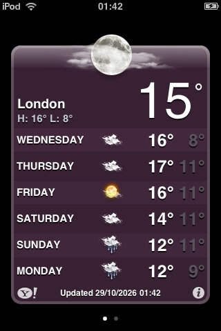

#
<p align="center">

<h1 align="center">OldWeather Fix</h1>
<h3 align="center">Fix the built-in Weather app on iOS 3.x</h3>
</p>

[简体中文](README_zh.md)

## Preview



## Introduction

**Everything runs on the device.** The tweak answers the Weather app's requests inside its own process and talks to the data source directly. No computer, no LAN server, no proxy, no backend — install the deb and it works standalone.

### Install: Download the `.deb` from [releases](https://github.com/lihaoyun6/OldWeather/releases/latest) page, and install it with `Cydia` or use `dpkg` cli.

## How it works

The iOS 3 Weather app POSTs to `<ServiceHost>/dgw` over plain HTTP; the host defaults to `iphone-wu.apple.com`. That service has been gone for years, but the app itself is unchanged.

The tweak registers an `NSURLProtocol` that intercepts `/dgw` and answers it locally. Open-Meteo is used as the data source because it still serves plain HTTP, which the old CFNetwork stack (no TLS 1.2) can actually speak.

Two request types:

| Request `type` | Purpose | Backend |
|---|---|---|
| `getlocationid` | city search | `geocoding-api.open-meteo.com` |
| `getforecastbylocationid` | weather | `api.open-meteo.com` |

### Two format details you must get right

1. **Weather replies use attributes, search replies use child text**

   The app reads weather fields with `xmlHasProp` (attributes) but search hits with `xmlNodeGetContent` (element text). Swap them and you get `nil`.

   ```xml
   <!-- weather -->
   <location id="CHXX0116|2151849" city="Shanghai" zip="..."/>
   <units temperature="F"/>
   <condition time="11:54 pm" temp="58" code="29" text="Partly Cloudy"/>

   <!-- search -->
   <item><id>OM|48.8534|2.3488|Paris</id><city>Paris</city>
         <region>Île-de-France</region><country>France</country></item>
   ```

2. **Exactly six `<forecast>` entries**

   Five entries make the app discard the whole response. `moonphase` must be an integer `1–24`, indexing `moon-1.png` … `moon-24.png`; text parses as 0 (new moon, black circle).

### City IDs

Search results carry their own coordinates: `OM|latitude|longitude|Display Name`. Weather requests parse that directly, so any place on earth works without a lookup table. Legacy `CHXX....|woeid` IDs from the app's shipped defaults are still supported.

## Build

```sh
./build.sh          # or make
./build.sh clean    # or make clean
# -> dist/OldWeather_v1.0.1_iphoneos-arm.deb
```

The SDK defaults to `$TMPDIR/sdk/iPhoneOS3.1.3.sdk`; override with `SDK=/path/to/sdk ./build.sh`.

Requires Xcode command line tools and `ldid`. Python is not needed.

## Network requirements

The device must be able to reach:

- `api.open-meteo.com` (port 80)
- `geocoding-api.open-meteo.com` (port 80)

## Credits

- Some code was generated using DeepSeek v4.1 Flash under human supervision.
