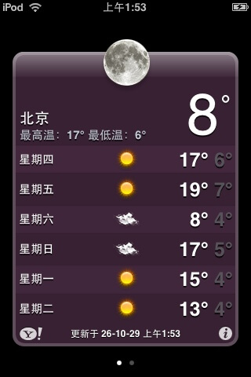

#
<p align="center">

<h1 align="center">OldWeather Fix</h1>
<h3 align="center">修复 iOS 3.x 内置天气应用的越狱插件</h3>
</p>

[English](README.md)

## 预览



## 简介

**本插件完全在设备本机运行**：插件在天气 App 进程内直接访问数据源并生成响应，
不需要电脑、局域网服务器、代理或任何后端。装上 deb 即可独立使用。

### 安装方法: 从 [Releases](https://github.com/lihaoyun6/OldWeather/releases/latest) 下载 `.deb` 并使用 `Cydia` 自动安装或使用 `dpkg` 命令进行安装.

## 原理

iOS 3 的天气 App 通过明文 HTTP 向 `<ServiceHost>/dgw` POST 请求，宿主默认
`iphone-wu.apple.com`。服务端早已下线，但 App 本身没变。

插件用 `NSURLProtocol` 拦截 `/dgw`，在进程内直接访问 Open-Meteo（它支持
明文 HTTP，旧 CFNetwork 不需要 TLS），并按照 App 的解析器生成响应。

两种请求：

| 请求 `type` | 用途 | 数据源 |
|---|---|---|
| `getlocationid` | 搜索城市 | `geocoding-api.open-meteo.com` |
| `getforecastbylocationid` | 取天气 | `api.open-meteo.com` |

### 两个必须遵守的格式细节

1. **天气响应用属性，搜索响应用子元素文本**

   App 对天气数据调用 `xmlHasProp`（读属性），对搜索结果调用
   `xmlNodeGetContent`（读子元素文本）。写反了就会得到 nil。

   ```xml
   <!-- 天气 -->
   <location id="CHXX0116|2151849" city="上海" zip="..."/>
   <units temperature="F"/>
   <condition time="11:54 pm" temp="58" code="29" text="Partly Cloudy"/>

   <!-- 搜索 -->
   <item><id>OM|48.8534|2.3488|巴黎</id><city>巴黎</city>
         <region>法兰西岛</region><country>法国</country></item>
   ```

2. **`<forecast>` 必须正好 6 条**

   少一条整个响应会被丢弃。`moonphase` 必须是 `1–24` 的整数，对应
   `moon-1.png` … `moon-24.png`；给文字会被解析成 0（新月，全黑）。

### 城市 ID

搜索返回的 ID 自带坐标：`OM|纬度|经度|显示名`。
天气请求时直接解析，因此任何城市都能用，不依赖内置表。
旧的 `CHXX....|woeid` 仍通过内置表兼容。

## 构建

```sh
./build.sh          # 或 make（转发到 build.sh）
./build.sh clean    # 或 make clean
# -> dist/OldWeather_v1.0.0_iphoneos-arm.deb
```

默认 SDK 路径 `$TMPDIR/sdk/iPhoneOS3.1.3.sdk`，可用 `SDK=/path/to/sdk ./build.sh` 覆盖。

需要：Xcode 命令行工具、`ldid`。不需要 Python。

## 网络要求

设备需要能访问：

- `api.open-meteo.com`（80）
- `geocoding-api.open-meteo.com`（80）

## 第三方

- 部分代码在有监督的情况下使用 DeepSeek v4.1 flash 生成
